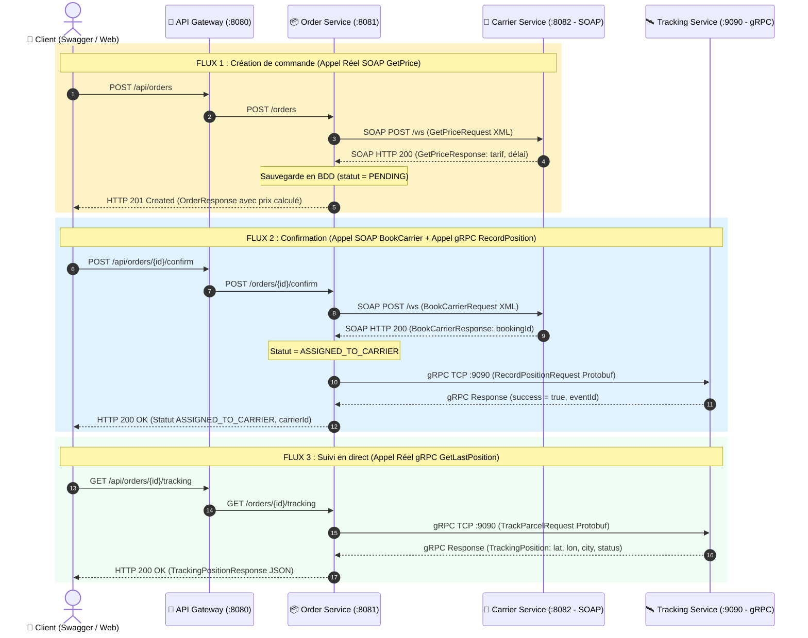

# 🚀 Guide Détaillé : Appels Réels Inter-Services & Focus gRPC
**Branche :** `feature/new-version`  
**Projet :** ParcelFlow (Mini-projet SOA 2026 - Dr. Ing. Ghada Feki)  
**Auteure :** Erij Kacem (avec Wiem, Malek, Yessine)

---

## 📌 1. Vue d'Ensemble des Changements de la "New Version"

Dans la nouvelle version (`feature/new-version`), l'équipe a franchi une étape majeure : **les appels inter-services sont désormais 100% réels et fonctionnels**.

Fini les simulations en mémoire ! L'**Order Service** est devenu un véritable orchestrateur SOA qui interagit en temps réel avec :
1. **`carrier-service` via SOAP 1.1** (port 8082) à travers `WebServiceTemplate` (JAXB2 et XML).
2. **`tracking-service` via gRPC sur HTTP/2** (port 9090) à travers un Stub gRPC typé généré par Protobuf.

---

## 🔄 2. Schéma et Explication des Appels Réels

Voici le cycle de vie complet d'une commande et les appels réseau exacts déclenchés :



---

## 🛠️ 3. Détail des Fichiers et Méthodes des Appels Réels

### 3.1. Côté `order-service` : Le Client SOAP (`CarrierSoapClient.java`)
Ce composant encapsule les communications vers le `carrier-service`.

* **Fichier :** `order-service/src/main/java/com/parcelflow/order/client/carrier/CarrierSoapClient.java`
* **Technologie :** `org.springframework.ws.client.core.WebServiceTemplate`
* **Méthode 1 : `getPrice(originCity, destinationCity, weightKg, carrierType)`**
  * Construit l'objet `GetPriceRequest`.
  * Exécute `carrierWebServiceTemplate.marshalSendAndReceive(request)`.
  * Convertit l'objet Java en enveloppe XML SOAP, l'envoie via HTTP POST sur `http://carrier-service:8082/ws`.
  * Réceptionne `GetPriceResponse` et extrait le prix et les jours estimés.
* **Méthode 2 : `bookCarrier(orderId, originCity, destinationCity, weightKg, carrierType)`**
  * Construit `BookCarrierRequest`.
  * Envoie la requête SOAP de réservation.
  * Réceptionne `bookingId` et `carrierId`.
* **Gestion des SOAP Faults :**
  * Si le transporteur refuse (ex: poids négatif ou ville inconnue), Spring-WS lève `SoapFaultClientException`.
  * La méthode `toBusinessFault()` extrait le code d'erreur (ex: `INVALID_WEIGHT`) et lance `CarrierFaultException` (traduite en **HTTP 422 Unprocessable Entity** par `GlobalExceptionHandler`).

---

### 3.2. Côté `order-service` : Le Client gRPC (`TrackingGrpcClient.java`)
Ce composant encapsule les appels gRPC vers le `tracking-service`.

* **Fichier :** `order-service/src/main/java/com/parcelflow/order/client/tracking/TrackingGrpcClient.java`
* **Injection :** `@GrpcClient("tracking-service") private TrackingServiceGrpc.TrackingServiceBlockingStub trackingStub;`
* **Gestion de la Deadline :**
  ```java
  private TrackingServiceGrpc.TrackingServiceBlockingStub stub() {
      return trackingStub.withDeadlineAfter(deadlineMs, TimeUnit.MILLISECONDS);
  }
  ```
  > **Important pour l'examen :** Chaque appel a une **deadline stricte** (par défaut 2000 ms). Si le Tracking Service ne répond pas dans ce délai, l'appel est interrompu avec le statut `DEADLINE_EXCEEDED` évitant de bloquer les threads du serveur.
* **Méthode 1 : `recordPosition(...)`**
  * Construit le message Protobuf `RecordPositionRequest`.
  * Appelle `stub().recordPosition(request)`.
  * Retourne l'identifiant de l'événement généré.
* **Méthode 2 : `getLastPosition(parcelId)`**
  * Appelle `stub().getLastPosition(TrackParcelRequest.newBuilder().setParcelId(parcelId).build())`.
  * Convertit le message Protobuf en DTO `TrackingPositionResponse`.
* **Méthode 3 : `getHistory(parcelId, limit)`**
  * Appelle `stub().getHistory(...)`.
  * Retourne la liste complète chronologique des étapes du colis.
* **Traduction des Erreurs gRPC :**
  * `NOT_FOUND` ➔ `OrderNotFoundException` (HTTP 404)
  * `INVALID_ARGUMENT` ➔ `IllegalArgumentException` (HTTP 400)
  * `UNAVAILABLE` ou `DEADLINE_EXCEEDED` ➔ `RemoteServiceUnavailableException` (HTTP 503)

---

### 3.3. L'Orchestration Métier (`OrderService.java`)
* **Fichier :** `order-service/src/main/java/com/parcelflow/order/service/OrderService.java`
* **À la création (`createOrder`) :**
  1. Appel réel SOAP `carrierClient.getPrice(...)`.
  2. Si le transporteur valide, création de l'entité `Order` avec le prix calculé et statut `PENDING`.
  3. Si le transporteur refuse (SOAP Fault), la commande n'est **jamais enregistrée** en BDD (intégrité garantie).
* **À la confirmation (`confirmOrder`) :**
  1. Vérification que la commande est bien `PENDING`.
  2. Appel réel SOAP `carrierClient.bookCarrier(...)` ➔ réservation confirmée.
  3. Mise à jour de la commande : statut `ASSIGNED_TO_CARRIER`, enregistrement du `carrierBookingId`.
  4. Appel réel gRPC `trackingClient.recordPosition(...)` pour initialiser le premier jalon GPS du colis avec les coordonnées de la ville de départ (`CityCoordinates.of(senderCity)`).

---

## 🎯 4. Focus Spécial sur la Partie gRPC (Erij)

En tant que responsable du **Tracking Service**, voici tout ce que tu dois savoir et expliquer sur ton code :

### 4.1. Le Contrat Protobuf (`src/main/proto/tracking.proto`)
Le contrat est le point de départ immuable de gRPC :
```protobuf
syntax = "proto3";

package tracking;

option java_package = "com.parcelflow.tracking.generated";
option java_multiple_files = true;

// Service de géolocalisation
service TrackingService {
  // RPC unaires (1 requête -> 1 réponse)
  rpc GetLastPosition(TrackParcelRequest) returns (TrackingPosition);
  rpc GetHistory(GetHistoryRequest) returns (GetHistoryResponse);
  rpc RecordPosition(RecordPositionRequest) returns (RecordPositionResponse);

  // RPC streaming serveur (1 requête -> flux continu de réponses)
  rpc StreamPositions(TrackParcelRequest) returns (stream TrackingPosition);
}
```

### 4.2. L'Implémentation du Serveur gRPC (`TrackingGrpcService.java`)
* **Fichier :** `tracking-service/src/main/java/com/parcelflow/tracking/grpc/TrackingGrpcService.java`
* **Héritage :** `extends TrackingServiceGrpc.TrackingServiceImplBase`
* **Annotation :** `@GrpcService` ➔ détecté par `grpc-server-spring-boot-starter` et écoute sur le port **9090**.

#### A. Les Appels Unaires (`getLastPosition`, `getHistory`, `recordPosition`)
Pattern standard avec `StreamObserver<T>` :
```java
@Override
public void getLastPosition(TrackParcelRequest request, StreamObserver<TrackingPosition> observer) {
    String parcelId = request.getParcelId();
    if (isBlank(parcelId)) {
        fail(observer, Status.INVALID_ARGUMENT, "parcel_id est obligatoire");
        return;
    }
    repository.findTopByParcelIdOrderByRecordedAtDesc(parcelId).ifPresentOrElse(
            position -> {
                observer.onNext(toProto(position)); // Envoyer le message
                observer.onCompleted();              // Clôturer l'appel
            },
            () -> fail(observer, Status.NOT_FOUND, "Aucune position pour : " + parcelId)
    );
}
```

#### B. Le Server Streaming (`streamPositions`) — La Pièce Maîtresse !
Cette méthode permet au client de recevoir les positions en direct sans faire de polling :
```java
@Override
public void streamPositions(TrackParcelRequest request, StreamObserver<TrackingPosition> observer) {
    String parcelId = request.getParcelId();
    List<TrackingPosition> positions = repository.findByParcelIdOrderByRecordedAtAsc(parcelId);
    
    for (TrackingPosition position : positions) {
        // Détection de l'annulation client (si le client ferme la page / coupe la connexion)
        if (observer instanceof ServerCallStreamObserver<?> call && call.isCancelled()) {
            log.info("StreamPositions annulé par le client");
            return;
        }
        observer.onNext(toProto(position)); // Émission d'une coordonnée dans le flux
        
        try {
            Thread.sleep(STREAM_DELAY_MS); // Pause de 500ms pour fluidité visuelle
        } catch (InterruptedException e) {
            fail(observer, Status.CANCELLED, "Flux interrompu");
            return;
        }
    }
    observer.onCompleted(); // Fin du flux
}
```

---

## 💻 5. Comment Démontrer ces Appels en Soutenance (Scénario Pas à Pas)

### Étape 1 : Créer une commande (Appel Réel REST ➔ SOAP)
Dans Swagger UI (`http://localhost:8081/swagger-ui.html`) ou avec `curl` :
```bash
curl -X POST http://localhost:8081/orders \
  -H "Content-Type: application/json" \
  -d '{
    "senderName": "Ahmed",
    "senderAddress": "Avenue Habib Bourguiba",
    "senderCity": "Tunis",
    "recipientName": "Sara",
    "recipientAddress": "Route de Teniour",
    "recipientCity": "Sfax",
    "weightKg": 3.5
  }'
```
* **Ce qui se passe :** `order-service` appelle `carrier-service` via SOAP.
* **Résultat :** Réponse 201 Created avec `shippingPrice: 17.25` et statut `PENDING`. Notez l'UUID de la commande (`id`).

---

### Étape 2 : Confirmer la commande (Appel Réel SOAP + gRPC)
```bash
curl -X POST http://localhost:8081/orders/{id}/confirm
```
* **Ce qui se passe :**
  1. Appel SOAP `BookCarrier` ➔ `carrier-service` réserve le transporteur.
  2. Appel gRPC `RecordPosition` ➔ `tracking-service` initialise la position GPS à Tunis (36.8065, 10.1815).
* **Résultat :** Statut passe à `ASSIGNED_TO_CARRIER`.

---

### Étape 3 : Simuler le déplacement du livreur (Appel Réel gRPC)
```bash
curl -X POST http://localhost:8081/orders/{id}/tracking/positions \
  -H "Content-Type: application/json" \
  -d '{
    "latitude": 35.8256,
    "longitude": 10.6084,
    "city": "Sousse",
    "status": "IN_TRANSIT",
    "description": "Colis scanné au centre de tri de Sousse"
  }'
```
* **Ce qui se passe :** Appel gRPC vers `tracking-service` qui enregistre ce nouveau point GPS. La commande passe à `IN_TRANSIT`.

---

### Étape 4 : Consulter le suivi en direct (Appel Réel gRPC)
```bash
# Dernière position connue
curl http://localhost:8081/orders/{id}/tracking

# Historique complet du trajet
curl http://localhost:8081/orders/{id}/tracking/history
```
* **Résultat :** Les données proviennent directement de la base `trackingdb` via gRPC !

---

### Étape 5 : Tester le Streaming gRPC avec `grpcurl` (Démonstration d'Erij)
Dans un terminal :
```bash
grpcurl -plaintext -d '{"parcel_id": "PF-2026-00001"}' localhost:9090 tracking.TrackingService/StreamPositions
```
Le professeur verra les positions GPS s'afficher une à une dans le terminal en temps réel !

---

## 🛡️ 6. Les Réponses d'Erij aux Questions du Jury

1. **"Erij, comment gérez-vous le cas où le tracking-service est éteint quand l'Order Service essaie de le contacter ?"**  
   > *"Dans `TrackingGrpcClient.java`, chaque appel gRPC dispose d'une **deadline stricte de 2 secondes** (`withDeadlineAfter`). Si le tracking est indisponible ou timeout, gRPC lève une `StatusRuntimeException` avec le code `UNAVAILABLE` ou `DEADLINE_EXCEEDED`. Notre client l'attrape et la traduit en `RemoteServiceUnavailableException` (HTTP 503). De plus, lors de la confirmation d'une commande, un échec du tracking n'empêche pas la confirmation de la commande : nous journalisons l'incident avec un warning pour assurer la résilience de notre service."*

2. **"Pourquoi avoir implémenté du Server Streaming plutôt qu'un appel unaire répété ?"**  
   > *"Un appel unaire répété (polling) oblige le client à envoyer continuellement des en-têtes HTTP et à surcharger le serveur de requêtes inutiles quand le livreur n'a pas bougé. Avec le **Server Streaming gRPC**, une seule connexion TCP sur HTTP/2 est établie, et c'est le serveur qui pousse les nouvelles coordonnées dès qu'elles sont disponibles, économisant ainsi la bande passante et la batterie des appareils mobiles."*
