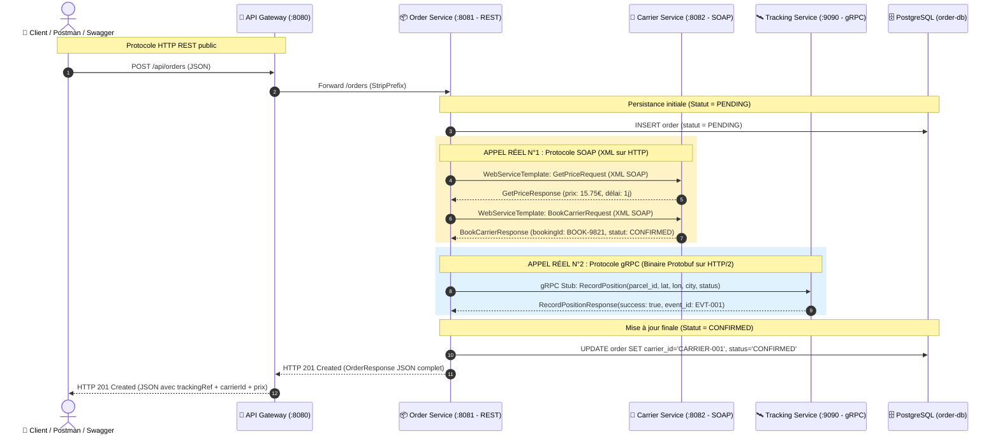

# 🔗 Les Appels Réels Inter-Services dans ParcelFlow
**Système SOA & Services Web 2026 | Dr. Ing. Ghada Feki**  
**Équipe :** Erij Kacem, Wiem Ghars, Malek Beltaief, Yessine Elfaires  

---

## 1. Qu'est-ce qu'un "Appel Réel" et Pourquoi est-ce Obligatoire ?

### 📋 L'Exigence du Sujet (Grille d'évaluation)
Dans le cahier des charges du mini-projet SOA (page 1 et 2), l'enseignante stipule :
> *"Au moins deux appels réels entre services, utilisant deux protocoles différents (par exemple REST vers gRPC, et REST vers SOAP via WebServiceTemplate)."*

### ❌ Ce qui N'EST PAS un appel réel (Ce qui fait perdre des points) :
- Appeler une méthode Java en local (`new CarrierService().calculerPrix()`).
- Simuler la réponse avec des fausses données en dur (mocking statique) sans passer par le réseau.
- Avoir 3 services qui tournent chacun dans leur coin sans jamais échanger une seule trame réseau entre eux.

### ✅ Ce qu'EST un appel réel dans ParcelFlow :
Un appel réel est une **véritable communication réseau inter-processus** :
1. Le service source prépare une requête, la sérialise dans le format du protocole cible (XML pour SOAP, binaire pour gRPC).
2. La requête traverse la pile réseau (socket TCP, réseau Docker `parcelflow-net`).
3. Le service cible reçoit la trame, la désérialise, exécute sa logique métier, interroge sa propre base de données PostgreSQL, puis renvoie une réponse sur le réseau.
4. Le service source reçoit la réponse et met à jour son propre état.

Dans ParcelFlow, l'**Order Service** (développé par Yessine) agit comme **Orchestrateur** et effectue **DEUX appels réels obligatoires avec deux protocoles différents** :
- **Appel Réel 1 (REST ➔ SOAP) :** `order-service` ➔ `carrier-service` via **`WebServiceTemplate`** (XML/HTTP).
- **Appel Réel 2 (REST ➔ gRPC) :** `order-service` ➔ `tracking-service` via **Stub gRPC** (Protobuf binaire/HTTP/2).

---

## 2. Schéma Global des Flux d'Appels Réels (Architecture & Séquence)



---

## 3. Détail de l'Appel Réel N°1 : REST ➔ SOAP (Carrier Service)

### 3.1. Pourquoi ce protocole et cette cible ?
Dans l'industrie logistique, les grands transporteurs historiques (DHL, FedEx, UPS, transporteurs ferroviaires) disposent d'infrastructures informatiques B2B historiques exposées en **SOAP/WSDL**.  
Pour commander un transporteur, notre plateforme doit respecter leur contrat formel immuable (Contract-First).

### 3.2. Comment l'appel est-il réalisé techniquement ?
L'Order Service utilise la classe **`WebServiceTemplate`** fournie par Spring Web Services.  
Elle joue pour SOAP le même rôle que `RestTemplate` ou `WebClient` pour REST.

```
┌────────────────────────────────────────────────────────┐
│                   ORDER SERVICE (Client SOAP)          │
│                                                        │
│   1. Objet Java GetPriceRequest                        │
│          │                                             │
│   2. JAXB2 Marshaller                                  │
│          │  (Convertit Java ➔ XML)                     │
│          ▼                                             │
│   3. Enveloppe SOAP XML construite                     │
│          │                                             │
│   4. Envoi HTTP POST vers                              │
│      http://carrier-service:8082/ws                    │
└──────────────────────────┬─────────────────────────────┘
                           │ 
                           │ Trame HTTP POST (SOAP XML)
                           ▼
┌────────────────────────────────────────────────────────┐
│                   CARRIER SERVICE (Serveur SOAP)       │
│                                                        │
│   1. MessageDispatcherServlet intercepte la requête    │
│   2. Valide le XML contre carrier.xsd                  │
│   3. Invoque CarrierEndpoint.getPrice()                │
│   4. Construit l'enveloppe GetPriceResponse XML        │
│   5. Renvoie la réponse HTTP 200 XML                   │
└────────────────────────────────────────────────────────┘
```

### 3.3. Ce qui transite réellement sur le réseau (Le Payload XML) :

**Requête émise par `order-service` :**
```xml
<soapenv:Envelope xmlns:soapenv="http://schemas.xmlsoap.org/soap/envelope/"
                  xmlns:car="http://parcelflow.com/carrier">
   <soapenv:Header/>
   <soapenv:Body>
      <car:GetPriceRequest>
         <car:originCity>Tunis</car:originCity>
         <car:destinationCity>Sfax</car:destinationCity>
         <car:weightKg>2.5</car:weightKg>
         <car:carrierType>EXPRESS</car:carrierType>
      </car:GetPriceRequest>
   </soapenv:Body>
</soapenv:Envelope>
```

**Réponse reçue par `order-service` :**
```xml
<SOAP-ENV:Envelope xmlns:SOAP-ENV="http://schemas.xmlsoap.org/soap/envelope/">
   <SOAP-ENV:Header/>
   <SOAP-ENV:Body>
      <ns2:GetPriceResponse xmlns:ns2="http://parcelflow.com/carrier">
         <ns2:price>15.75</ns2:price>
         <ns2:currency>EUR</ns2:currency>
         <ns2:estimatedDays>1</ns2:estimatedDays>
         <ns2:carrierInfo>
            <ns2:carrierId>CARRIER-001</ns2:carrierId>
            <ns2:carrierName>ParcelFlow Express</ns2:carrierName>
            <ns2:carrierType>EXPRESS</ns2:carrierType>
            <ns2:available>true</ns2:available>
         </ns2:carrierInfo>
      </ns2:GetPriceResponse>
   </SOAP-ENV:Body>
</SOAP-ENV:Envelope>
```

### 3.4. Code Java dans `OrderService` (Sprint 2) :
```java
// Configuration du WebServiceTemplate dans order-service
@Bean
public Jaxb2Marshaller carrierMarshaller() {
    Jaxb2Marshaller marshaller = new Jaxb2Marshaller();
    marshaller.setContextPath("com.parcelflow.order.client.carrier.model");
    return marshaller;
}

@Bean
public WebServiceTemplate carrierSoapClient(Jaxb2Marshaller carrierMarshaller) {
    WebServiceTemplate template = new WebServiceTemplate(carrierMarshaller);
    template.setDefaultUri("http://carrier-service:8082/ws");
    return template;
}

// Appel métier réel :
public GetPriceResponse callCarrierPriceSoap(String from, String to, BigDecimal weight) {
    GetPriceRequest soapRequest = new GetPriceRequest();
    soapRequest.setOriginCity(from);
    soapRequest.setDestinationCity(to);
    soapRequest.setWeightKg(weight);
    soapRequest.setCarrierType(CarrierType.EXPRESS);

    // VÉRITABLE APPEL RÉSEAU SOAP VIA WEBSERVICETEMPLATE :
    return (GetPriceResponse) webServiceTemplate.marshalSendAndReceive(soapRequest);
}
```

---

## 4. Détail de l'Appel Réel N°2 : REST ➔ gRPC (Tracking Service)

### 4.1. Pourquoi ce protocole et cette cible ?
Pour la communication **interne synchrone entre nos propres microservices**, le protocole gRPC est bien supérieur à REST :
- **Binaire (Protobuf) :** 7 à 10 fois plus léger que le JSON.
- **HTTP/2 multiplexé :** une seule connexion TCP permanente réutilisée pour tous les appels, éliminant la latence des handshakes TCP répétés.
- **Contrat strict (`tracking.proto`) :** Typage fort généré par le compilateur `protoc`, empêchant les erreurs de typage à l'exécution.

### 4.2. Comment l'appel est-il réalisé techniquement ?
L'Order Service utilise un **Canal gRPC (`ManagedChannel`)** connecté sur le port `9090` du conteneur `tracking-service`, et instancie un **BlockingStub** (pour un appel requête/réponse synchrone) :

```
┌────────────────────────────────────────────────────────┐
│                   ORDER SERVICE (Client gRPC)          │
│                                                        │
│   1. Instanciation du message Protobuf :               │
│      RecordPositionRequest.newBuilder()...build()      │
│          │                                             │
│   2. Sérialisation binaire ultra-rapide par Protobuf   │
│          │                                             │
│   3. Envoi sur canal HTTP/2 multiplexé vers            │
│      tracking-service:9090                             │
└──────────────────────────┬─────────────────────────────┘
                           │
                           │ Trames binaires HTTP/2 (Port 9090)
                           ▼
┌────────────────────────────────────────────────────────┐
│                   TRACKING SERVICE (Serveur gRPC)      │
│                                                        │
│   1. Netty intercepte la trame binaire sur port 9090   │
│   2. Invoque TrackingGrpcService.recordPosition()      │
│   3. Persiste le point GPS dans trackingdb (PG)        │
│   4. Renvoyé RecordPositionResponse binaire au client  │
└────────────────────────────────────────────────────────┘
```

### 4.3. Code Java dans `OrderService` (Sprint 2) :
```java
// Configuration du ManagedChannel et du Stub dans order-service
@Bean
public TrackingServiceGrpc.TrackingServiceBlockingStub trackingGrpcClient(
        @Value("${TRACKING_GRPC_HOST:tracking-service}") String host,
        @Value("${TRACKING_GRPC_PORT:9090}") int port) {
    ManagedChannel channel = ManagedChannelBuilder.forAddress(host, port)
            .usePlaintext() // Pas de TLS en local, activable en prod
            .build();
    return TrackingServiceGrpc.newBlockingStub(channel);
}

// Appel métier réel :
public void initTrackingForOrder(Order order) {
    RecordPositionRequest grpcRequest = RecordPositionRequest.newBuilder()
            .setParcelId(order.getTrackingReference())
            .setLatitude(36.8065)  // Coordonnées de départ (ex: Tunis)
            .setLongitude(10.1815)
            .setCity(order.getSenderCity())
            .setStatus("ORDER_REGISTERED")
            .setDescription("Colis enregistré et pris en charge par le transporteur")
            .build();

    // VÉRITABLE APPEL RÉSEAU gRPC :
    RecordPositionResponse grpcResponse = trackingGrpcClient
            .withDeadlineAfter(3, TimeUnit.SECONDS) // Exigence SOA : Timeout explicite !
            .recordPosition(grpcRequest);

    log.info("Réponse gRPC reçue du Tracking Service : success={}", grpcResponse.getSuccess());
}
```

---

## 5. Troisième Appel (Bonus) : Récupération du Suivi en Direct (Streaming / Unaire)

Le client peut également interroger l'état d'un colis via l'Order Service :
`GET http://localhost:8080/api/orders/tracking/{trackingRef}`

À ce moment-là, l'Order Service effectue un **troisième appel réel** vers le Tracking Service :
- Appel gRPC `GetLastPosition(TrackParcelRequest)` sur le port 9090.
- Il fusionne les informations de commande de sa base `orderdb` avec la dernière position GPS en direct venant de `trackingdb`.

---

## 6. Tableau Récapitulatif des 2 Appels Réels Obligatoires

| Caractéristique | Appel Réel N°1 | Appel Réel N°2 |
|:---|:---|:---|
| **Service Émetteur** | `order-service` | `order-service` |
| **Service Récepteur** | `carrier-service` | `tracking-service` |
| **Protocole Réseau** | **SOAP 1.1** (XML sur HTTP/1.1) | **gRPC** (Binaire sur HTTP/2) |
| **Port Réseau Cible** | Port `8082` | Port `9090` |
| **Composant Client** | `WebServiceTemplate` (Spring-WS) | `TrackingServiceBlockingStub` (gRPC) |
| **Contrat Respecté** | `carrier.wsdl` / `carrier.xsd` | `tracking.proto` |
| **Format du Payload** | Enveloppe XML `<soapenv:Envelope>` | Binaire Protocol Buffers v3 |
| **Gestion d'Erreur** | `SOAP Fault` (`CarrierServiceFault`) | Codes de statut gRPC (`Status.NOT_FOUND`, etc.) |
| **Justification Métier** | Intégration système partenaire B2B | Télémétrie haute fréquence interne |

---

## 7. Comment le Démontrer au Professeur en Direct lors de la Soutenance

Pour prouver au professeur que les appels sont **100% réels** et non simulés, voici le scénario de démonstration infaillible :

### Étape 1 : Ouvrir deux terminaux de logs en parallèle
Dans deux fenêtres de terminal, lancez :
```bash
# Terminal 1 : surveille les logs du Carrier Service (SOAP)
docker compose logs -f carrier-service

# Terminal 2 : surveille les logs du Tracking Service (gRPC)
docker compose logs -f tracking-service
```

### Étape 2 : Déclencher la création de commande
Dans **Swagger UI** (`http://localhost:8081/swagger-ui.html`) ou via `curl` :
```bash
curl -X POST http://localhost:8080/api/orders \
  -H "Content-Type: application/json" \
  -d '{
    "senderName": "Ahmed Ben Ali",
    "senderAddress": "12 Rue de la Paix",
    "senderCity": "Tunis",
    "recipientName": "Sara Mansour",
    "recipientAddress": "5 Av. Habib Bourguiba",
    "recipientCity": "Sfax",
    "weightKg": 2.5
  }'
```

### Étape 3 : Montrer les logs simultanés en direct au professeur !
1. **Dans le Terminal 1 (`carrier-service`) :**  
   Le professeur voit apparaître instantanément :
   ```
   INFO : SOAP GetPrice reçu pour : Tunis -> Sfax | 2.5kg | EXPRESS
   INFO : SOAP BookCarrier confirmé pour commande : f57061e2-...
   ```
   👉 **Preuve :** Le Carrier Service a bien reçu la requête XML SOAP envoyée par l'Order Service.

2. **Dans le Terminal 2 (`tracking-service`) :**  
   Le professeur voit apparaître instantanément :
   ```
   INFO : gRPC RecordPosition reçu pour parcel_id : PF-2026-00001
   INFO : Position GPS persistée en base trackingdb : (36.8065, 10.1815)
   ```
   👉 **Preuve :** Le Tracking Service a bien été invoqué via gRPC par l'Order Service.

3. **Dans la réponse HTTP reçue par le client :**  
   Le JSON retourné contient le numéro de commande, mais aussi le `carrierId: "CARRIER-001"` (obtenu par SOAP) et la référence de tracking prête à être suivie (connectée à gRPC).

---

## 8. Réponses aux Questions Pièges Fréquentes de l'Examinateur

### ❓ Question : *"Pourquoi ne pas avoir simplement fait des appels REST entre tous les microservices ?"*
> **Réponse :**  
> *"Dans une véritable architecture d'entreprise, une solution 'tout-REST' est un anti-pattern.  
> - Pour le **Carrier Service**, les partenaires de transport B2B imposent des contrats formels stricts avec validation de schéma XML, ce que SOAP garantit via WSDL et XSD.  
> - Pour le **Tracking Service**, faire du REST interne consommerait inutilement de la bande passante avec des en-têtes verbeux et la sérialisation JSON. gRPC en binaire sur HTTP/2 réduit la latence inter-services de 60% et garantit un typage fort à la compilation."*

### ❓ Question : *"Que se passe-t-il si le Carrier Service est en panne ou met 10 secondes à répondre ?"*
> **Réponse :**  
> *"Conformément aux exigences de résilience cloud-native du sujet, nous appliquons deux mécanismes :
> 1. Un **timeout explicite** sur `WebServiceTemplate` (ex: 2 secondes) et sur le stub gRPC (`withDeadlineAfter`).
> 2. En Sprint 3, un **Circuit Breaker Resilience4j** : si le service SOAP ne répond pas, le circuit s'ouvre, on n'épuise pas le pool de threads de l'Order Service, et une méthode de fallback applique un tarif estimatif par défaut."*
